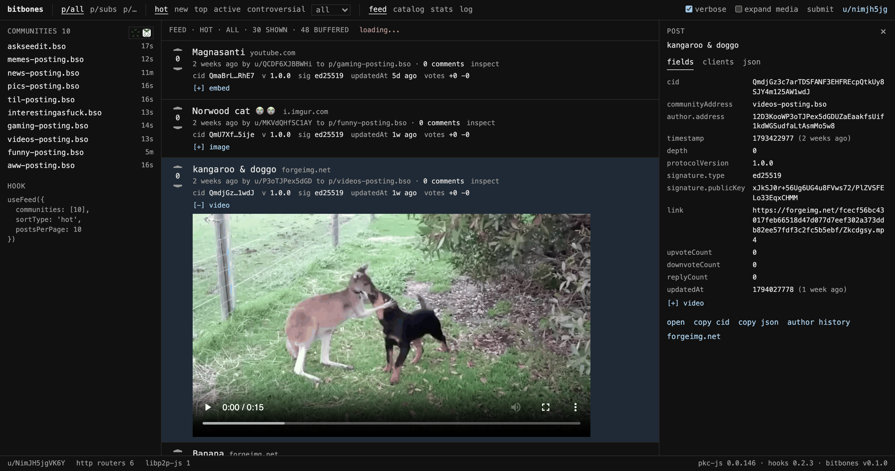

<div align="center">


# bitbones

A developer client for Bitsocial that shows the protocol data behind every view.

[Web app](https://bitbones.app) · [Desktop and Android](https://github.com/bitsocialnet/bitbones/releases/latest) · [Bitsocial](https://bitsocial.net) · [React hooks](https://github.com/bitsocialnet/bitsocial-react-hooks)

[](https://github.com/bitsocialnet/bitbones/releases/latest)
[](https://github.com/bitsocialnet/bitbones/blob/master/LICENSE)
[](http://commitizen.github.io/cz-cli/)

</div>



bitbones works like a browser's devtools for the [Bitsocial protocol](https://bitsocial.net). Every view is a thin wrapper over [`@bitsocial/bitsocial-react-hooks`](https://github.com/bitsocialnet/bitsocial-react-hooks) and shows the hook call and the protocol data behind it, so it is the fastest place to reproduce a bug, watch a community load, or try a hooks change against real communities.

## Download

| Platform | Where | Notes |
| --- | --- | --- |
| Web | [bitbones.app](https://bitbones.app) | static client, content comes from peers |
| Mac, Windows, Linux | [release page](https://github.com/bitsocialnet/bitbones/releases/latest) | runs a full peer-to-peer Bitsocial node and seeds automatically |
| Android | [release page](https://github.com/bitsocialnet/bitbones/releases/latest) | |

## What it shows

- **Three panes.** The left pane lists the communities behind the current feed, each with the age of its last update or its loading state, and the `useFeed` call that built the feed. On community and post pages it shows the community, its rules and its record (`publicKey`, `updatedAt`, `protocolVersion`, challenges, roles, client states). The right pane inspects whatever post or reply you click: its fields, which clients are working on it, and the raw JSON. With nothing clicked it shows the `useFeed` result.
- **Verbose mode** (topbar toggle, on by default) adds one line under each post and reply: short cid, protocol version, signature type, update age and votes.
- **Media** is collapsed behind `[+]` by default. The **expand media** toggle in the topbar expands or collapses everything at once and is remembered for new posts; a single `[+]`/`[−]` still overrides it.
- **`/stats`** tables `useCommunityStats` (active users, posts and replies per hour, day, week, month, year or all time) for the default list and your subscriptions, plus `useCommunitiesStates` and the client urls from `pkcOptions`.
- **`/log`** records the pkc-js and hooks debug logs (trace level excluded) and shows them in the app instead of the browser console, with filters and search. Recording is off by default, survives reloads until stopped, and redacts fields that look like secrets.
- **Themes** are one block of CSS variables each in [`src/themes.css`](src/themes.css): dark (the default), light, auto, classic (the original verdana look), none (browser defaults), term and contrast. Settings also takes custom CSS, applied after the theme.
- The status bar shows the active account, how many clients of each kind `pkcOptions` lists, and the pkc-js, hooks and bitbones versions.

## Switching default community lists

bitbones does not curate its own default communities. The feed reads whichever client's list you pick, straight from [bitsocialnet/lists](https://github.com/bitsocialnet/lists):

- **seedit** — [`seedit-default-subscriptions.json`](https://github.com/bitsocialnet/lists/blob/master/seedit-default-subscriptions.json), the exact communities new Seedit accounts subscribe to.
- **5chan** — [`5chan-directories/`](https://github.com/bitsocialnet/lists/tree/master/5chan-directories), resolved the way 5chan resolves it: one winning board per directory code, ranked by score, then by when it was added, then by address.

The switch sits at the top of the communities pane on the home feed (`/#/`) and shows both client marks, the active one lit. The selection persists in `localStorage` under `bitbonesDefaultList`. Both lists are also vendored into `src/data/` at build time by `yarn sync:lists`, so bitbones still has a feed when GitHub is unreachable.

seedit is the default because its list is 10 communities against 5chan's 64, and every extra community is another name resolution and page fetch on a cold peer-to-peer start.

## Development

```sh-session
nvm install
nvm use
corepack enable
yarn install
yarn start
```

| command | what it does |
| --- | --- |
| `yarn start` | vite dev server at https://bitbones.localhost through portless, or http://localhost:5173 with `PORTLESS=0` |
| `yarn build` | production build into `build/` |
| `yarn sync:lists` | refresh the vendored default community lists from bitsocialnet/lists |
| `yarn lint` | oxlint |
| `yarn type-check` | `tsc --noEmit` over `src/` |
| `yarn prettier` | oxfmt |
| `yarn knip` | unused/undeclared dependency check |
| `yarn electron:dev` | run the desktop app against the dev server |
| `yarn electron:make` | package the desktop app |

## Contributing

See [CONTRIBUTING.md](CONTRIBUTING.md) for setup, code conventions, verification, and pull requests, [PRODUCT.md](PRODUCT.md) for product purpose, [DESIGN.md](DESIGN.md) for the design system, and [versioning and v1 readiness](docs/agent-playbooks/versioning.md) for release policy.

## Origins

bitbones is a port of an existing GPL bare-bones client onto the Bitsocial stack: `@bitsocial/bitsocial-react-hooks` for all protocol access, communities throughout, and the dependency stack brought up to the same versions 5chan and Seedit run. The first commit in this repository is the unmodified upstream source, so the entire port is reviewable as a single diff.

## License

GPL-3.0-or-later — see [LICENSE](LICENSE).
